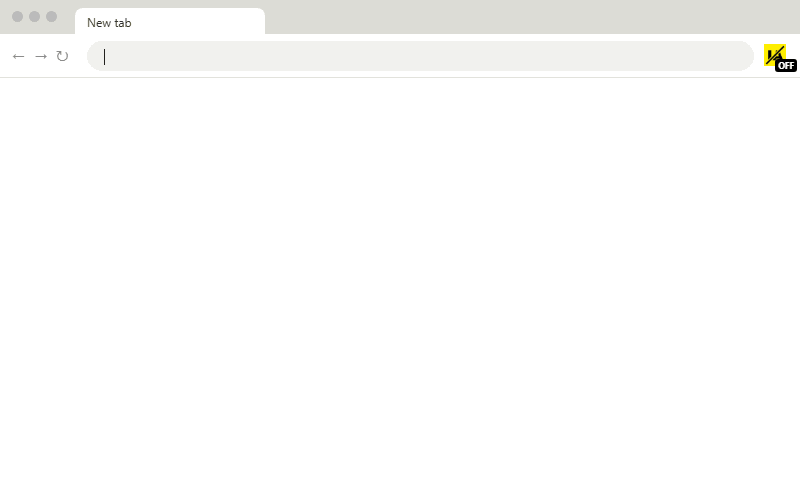

# Dia sense IA (No-AI Day)

A browser extension that blocks ChatGPT, Claude, Gemini, Copilot and other assistants one day a week. On that day, opening any of them shows a poster in the style of the "Día sin IVA" sale posters: "Today is" on top, then "No-AI Day" with the AI in a tilted black tag, and a short line under it.

The name is Catalan for "No-AI Day". It comes from the "Día sin IVA" (VAT-free day) sales that Spanish appliance stores run.

## Why

AI is useful, and most days it saves a lot of time. But some things are worth keeping in practice: reading the docs, remembering a command, working out a bug on your own. One day a week, the extension closes the AI chats in your browser so you get to do that.

It is easy to get around: turn it off or use another browser. It is a reminder, not a lock.

## Status

Version 1.0.0. What is left is in [TODO.md](TODO.md).

## What it does

- On the chosen day (Friday by default) it redirects the sites on the list to a block page.
- You can pick one or more days in the options.
- On that day the icon shows "OFF".
- The texts are in Catalan, Spanish and English, depending on the browser language.

The list of sites is in [src/sites.js](src/sites.js).

It does not block anything outside the browser: assistants in your editor and terminal keep working.

## Install

Chrome, Edge or Brave: install it from the [Chrome Web Store](https://chromewebstore.google.com/detail/no-ai-day/olafbhngobkklpeheibajildnofbhbfa).

Firefox (140 or later): install it from [Firefox Add-ons](https://addons.mozilla.org/addon/no-ai-day/).

To try the source instead:

- In Chrome, Edge or Brave, clone the repository, open `chrome://extensions`, turn on developer mode, click "Load unpacked" and choose the project folder.
- In Firefox, open `about:debugging#/runtime/this-firefox`, click "Load Temporary Add-on" and choose `manifest.json`. The add-on is removed when you close Firefox.

## Privacy

The extension does not collect or send any data. It only stores the days you pick, using the browser's storage.

## Contributing

If a site is missing from the list or you have a better line for the poster, open an issue or a pull request.

## License

MIT. Made by [Metalinked](https://metalinked.net).
